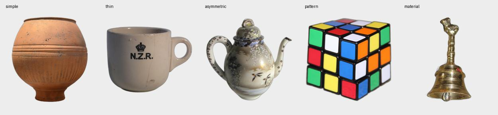
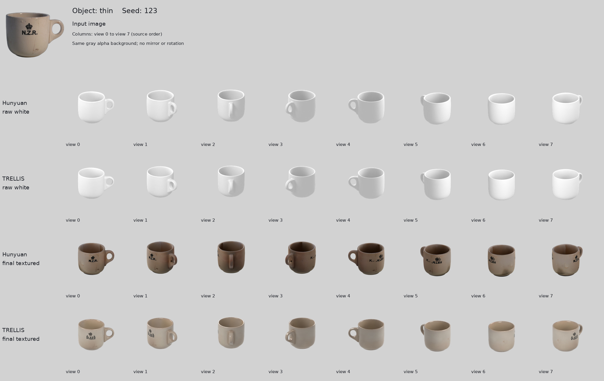
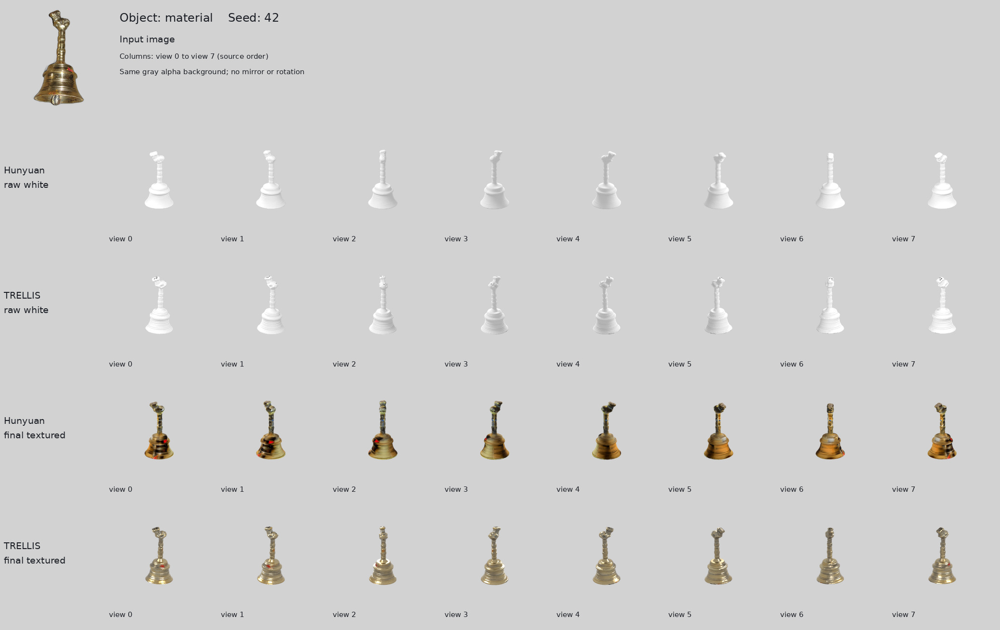

# pilot03：五张照片的模型选型预实验

2026-11-07，香港时间。使用相同的五张前景照片、种子 42 和 123，在 HKUST HPC4 的 NVIDIA L20 上比较 Hunyuan3D-2 与 TRELLIS.2。每模型 10 次生成，共 20 次；本轮全部完成，产物哈希、GLB 几何和内嵌贴图检查通过。

**当前建议：课程项目先以混元作为成本较低的基线；保留 TRELLIS.2 作为几何细节和材质表现的对照。** 本轮混元在杯子文字、规则色块和朝向稳定性上较好，生成更快、文件更小；TRELLIS.2 在陶罐刻纹、铜铃环槽及金属观感上有优势。五个样本不足以认定某模型全面胜出，正式选择仍应在 GSO 开发集上验证，独立测试集保持未参与选型。

这里的画质判断是 **AI 辅助的主观视觉审阅**，依据两种子、白模与材质模型的全部八视角；不是人工盲评、真实几何精度或自动评分。

## 输入和实际运行范围



| ID | 实物特征 | 观察重点 |
|---|---|---|
| simple | 陶罐 | 容器开口、整体轮廓、环纹与细刻纹 |
| thin | 印有 N.Z.R. 的杯子 | 杯柄孔洞、杯口、可见文字 |
| asymmetric | 带柄和细嘴的茶壶 | 非对称部件、壶嘴、花纹与两种子稳定性 |
| pattern | 魔方 | 规则网格、色块、边缘及图案一致性 |
| material | 金属手铃 | 环槽、顶部小装饰、金属外观 |

每种子都单独生成。首样例作业是混元 `2210432`、TRELLIS.2 `2210433`；续跑作业 `2210714`、`2210716` 分别新增 9 项。首项的恢复跳过没有算成一次新生成。最后的生成作业于 **11 月 7 日 00:11:58** 结束。

较早的 pilot02 有两次首样例失败：混元在高面数纹理处理时达到项目单样例超时；TRELLIS.2 在 C++ 运行库导入时失败。pilot03 在混元 Paint 前仅对纹理副本减面，并在 TRELLIS 作业内选择匹配的 GCC 12 运行库，再重新执行完整计划。**本页 20/20 是修复后这一轮的成功率，不代表从首次安装起从未失败。**

## 运行成本

完整数字和每项来源见 [metrics.json](metrics.json)、[runs.csv](runs.csv)。先平均同一对象的两个种子，再对五个对象等权平均。

| 指标 | 混元 3D 2.0 | TRELLIS.2 |
|---|---:|---:|
| 本轮生成完成 | 10/10 | 10/10 |
| 平均管线耗时（含加载） | 120.63 秒 | 313.27 秒 |
| 平均真实进程耗时 | 122.55 秒 | 315.46 秒 |
| 单项管线耗时范围 | 100.26–157.71 秒 | 235.38–425.37 秒 |
| PyTorch peak allocated 平均值 | 14.49 GiB | 6.28 GiB |
| 最终 GLB 平均体积 | 3.50 MiB | 40.46 MiB |
| 最终 GLB 平均三角面数 | 40,000 | 967,233 |

这些耗时不含排队、安装、下载或本页的 Blender 渲染。两模型的 `simple/42` 在续跑时各有一次不足两秒的跳过记录；公开统计采用包围首次成功管线的真实进程记录，排除了这两个跳过值。`pilot-report` 的原始结果另行保留，其中最后一次 process 记录可能是恢复跳过，应结合原始 attempts 解读。

显存值来自 PyTorch 分配器，原生 CUDA 库可能另占显存，不能据此把 TRELLIS.2 的整卡需求定为 6.28 GiB。两套管线的阶段定义也不同：TRELLIS.2 的 `native_shape_material` 合并形状与材质，混元分别记录 shape、减面与 Paint；不直接比较不等价的局部阶段。

本轮比较的是已配置的完整系统。混元纹理副本减到 40,000 面，原始白模保留；TRELLIS.2 最终导出目标约 1,000,000 面。输入预处理及生成分辨率也不同。文件大小、速度和细节容量受这些配置影响，**面数多本身不是质量分数，也不是等计算预算实验**。

## 视觉观察

| 对象 | 混元：两个种子的共同表现 | TRELLIS.2：两个种子的共同表现 | 本轮判断 |
|---|---|---|---|
| 陶罐 | 开口和大轮廓完整；横向环纹清楚；细竖纹在白模中较弱，颜色更橙、明暗较强 | 白模能看到更多细竖纹与环槽；材质呈较哑光的陶土感；两个种子的斑驳程度不同 | TRELLIS 的细表面结构更丰富；两者都能用于粗略展示 |
| 杯子 | 保留开口与闭合杯柄；输入正面的 N.Z.R. 基本可辨；内壁有方块状色差，背面出现了输入未提供的额外文字 | 开口与杯柄也形成；杯身文字变成不正确的字形；seed 42 与 123 的原生朝向不同 | 本轮混元的可见文字还原更好，但内壁贴图有瑕疵；两者都不能保证未见背面图案正确 |
| 茶壶 | 柄和嘴均保留，两个种子整体朝向较一致；原图花纹较可辨，色调偏黄褐，背面花纹被补全 | 柄和嘴均保留；花纹和反光呈斑驳感，seed 123 尤其明显；两种子的原生朝向相差较大 | 混元在这张输入的可见装饰还原和种子一致性上较稳；两者仍有细节变形 |
| 魔方 | 色块饱和、黑色边框清楚，白模轮廓较规整；两个种子的部分色块安排仍有变化 | 网格和各色面可辨，但色块较暗淡，边缘/表面有细小不平整和较强高光 | 这张输入下混元的图案观感更清晰；不宣称任一结果严格还原了魔方全部六面 |
| 手铃 | 轮廓和细柄保留；白模的钟身环槽较弱，颜色纹理带有明显明暗条带；顶部小装饰简化 | 白模环槽更清晰，金属高光更明显；顶部小装饰也有变形，seed 123 的形状和颜色与 seed 42 有差别 | TRELLIS 更适合继续检查该例的细节与金属表现；两者都不是高保真复刻 |

输入只提供单张照片。背面新增图案可以指出其“未受输入验证”，但没有真实背面或三维模型，不能把这些区域直接计为几何误差。陶罐内部、杯内深度、铃内结构也没有得到真值验收。主观色彩/反光差异不是 BRDF 或材质物理精度测量。

## 完整对比图：两个种子都保留

每张图从上到下为：混元原始白模、TRELLIS 原始白模、混元最终材质、TRELLIS 最终材质。每行覆盖八个相机编号，没有挑选单个“最佳结果”。

| 对象 | seed 42 | seed 123 |
|---|---|---|
| 陶罐 | [八视角对比](gallery/simple-seed-42.jpg) | [八视角对比](gallery/simple-seed-123.jpg) |
| 杯子 | [八视角对比](gallery/thin-seed-42.jpg) | [八视角对比](gallery/thin-seed-123.jpg) |
| 茶壶 | [八视角对比](gallery/asymmetric-seed-42.jpg) | [八视角对比](gallery/asymmetric-seed-123.jpg) |
| 魔方 | [八视角对比](gallery/pattern-seed-42.jpg) | [八视角对比](gallery/pattern-seed-123.jpg) |
| 手铃 | [八视角对比](gallery/material-seed-42.jpg) | [八视角对比](gallery/material-seed-123.jpg) |





### 渲染和朝向边界

使用项目已有 `blender_render.py`，Blender **4.5.15 LTS / Cycles CPU / 32 samples / 512×512**，固定随机种子 2026、正交相机、相同双面积光和世界环境。每个模型按包围盒居中并用正的均匀比例缩放；白模来自 `shape_raw.glb`，材质图来自 `asset.glb`。CPU 作业 `2211167` 生成 40 组、320 帧，全部通过八张 PNG 和相机记录检查。联系图只缩小和合成相同灰背景，没有镜像、旋转或换列。

**同一相机编号表示相同世界相机，不保证是物体的同一侧。** 茶壶 seed 42 的 TRELLIS view 0 为嘴左柄右，seed 123 的 view 0 为嘴右柄左；杯子也有类似的种子间朝向变化。原始白模哈希和相机记录已核对，这不是联系图排序错误。为保持证据，本轮保留原生朝向并检查完整环视，没有对所有 TRELLIS 结果施加固定 180° 校正，也没有逐样本挑最佳视角。

八视角是固定仰角的水平环视，并不包含独立的垂直俯视或底视。因此本页不声称完成了底部、容器内部等隐藏区域的全面视觉验收。原始 GLB 可在 Blender 中继续检查。

## 文件、校验与复现

完整原始输出放在 [pilot03 Release](https://github.com/Zr21340398/cv-final-project/releases/tag/pilot03-2026-11-07)，大 GLB 不进入 Git 历史。每个 `pilot03-MODEL-OBJECT.tar.gz` 包含该物体的两个种子、原始白模、最终模型、输入、manifest、进程记录和冻结计划。元数据与评价预览另包发布，附件 SHA256 见 Release 的校验清单。所有包在同一目录解压即可合并为结果目录；归档不含模型权重。

```bash
# 对已下载附件先检查 SHA256，再解压。
shasum -a 256 -c SHA256SUMS
for archive in pilot03-*.tar.gz; do tar -xzf "$archive"; done

# 在具有冻结计划原路径和原实验源码的服务器环境，使用项目汇总程序。
asset3d pilot-report --experiment results/pilot03 --output results/pilot03-evaluation/summary

# 用发布的记录快照复算本页统计（不需要GPU或模型权重）。
python scripts/summarize_pilot_records.py --records pilot03-analysis/pilot03-records.json --output pilot03-metrics

# 用已下载的原始预览图重建联系图（需要Pillow）。
python scripts/build_pilot_contact_sheets.py --results pilot03 --evaluation pilot03-evaluation --output pilot03-gallery
```

冻结计划含服务器输入绝对路径；在 Mac 上直接调用 `pilot-report` / `pilot-render` 的 `read_plan` 检查可能因路径不同而拒绝运行。不要为绕过检查改写冻结计划：使用已发布的汇总，或对单个本地 GLB 调用项目渲染脚本。

运行所用源码指纹为 `fe5e374cb5f63fc505237c5b8e8751a054ea8dbb00e942408819262e6bfa9475`。固定模型版本、配置与每项输入/产物哈希保存在原始记录及公开统计中。发布前本地 CPU 测试为 **42 passed, 1 skipped**；跳过的是可选 Gradio UI 测试，不影响已经在 L20 完成的真实生成。
